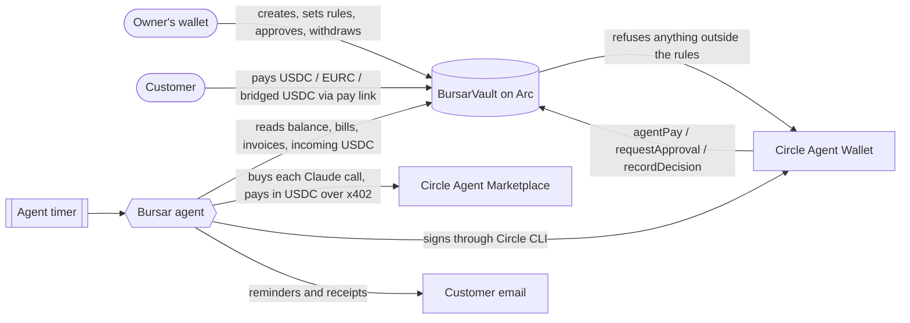

# Bursar

Bursar is an AI agent that runs a small business's money in USDC on [Arc](https://arc.io). It collects what customers owe, chases late payers, pays bills, keeps a reserve, saves, and checks every wallet before money moves.

The agent decides; the contract has the final say. The owner's rules live in a vault contract that only the owner's wallet owns, so the agent can't pay outside them, even if it gets something wrong or is tricked.

Built for the Tameion Agents Hackathon (Canteen x Circle x Arc), brief 04: Autonomous Business Operator.

- Demo video: https://x.com/myacxt/status/2111430594336879085
- Live site: https://bursar.myacxt.site
- Contracts on Arc mainnet: [BursarFactory](https://explorer.arc.io/address/0x1d872C07C1935fe5E3a28a9df0690C2caf7B5709) (every business vault created shows up in its Transactions tab)

## The problem

A small business owner is also the bookkeeper, the debt collector and the treasurer. Invoices go unchased, bills get paid late or twice, and cash sits idle. An AI agent could do this work, but handing an agent the keys to a business's money is reckless: a model can misread an invoice, pay the wrong wallet, retry and pay twice, or be tricked by a fake bill.

Bursar's answer is to split the job in two. **The agent decides. The contract has the final say.** The owner writes their limits into a vault contract on Arc, and the agent's key can only move money inside those limits. A wrong or tricked agent still can't overspend, dip below the cash floor, pay an unapproved wallet or pay the same bill twice.

## How it works



1. **The owner signs up with a wallet** (they sign a one-time message, no password) and creates a vault from the factory in one transaction. They set two numbers to start: "Most the agent may pay at once" and "Cash to always keep". Budgets and supplier approvals come next on the Rules & settings page, and every rule change goes to the vault in one transaction. Savings pots live in a separate savings contract.
2. **The owner adds customers and invoices.** Each invoice gets a pay link and a QR code. The customer pays straight into the vault from their own wallet, and Bursar never holds the money.
3. **The agent runs by itself** on a timer (every 6 hours by default, or on demand with "Run now"). Each run it reads the vault and the books, asks Claude what to do, and acts only through a small set of tools (below). Each tool re-checks the facts in code before acting, and the vault re-checks the rules onchain.
4. **Anything the agent can't or shouldn't do alone becomes an approval request.** The owner sees it on the Approvals page and approves or rejects it from their own wallet.
5. **Every step is written to the decision log** with the agent's reason, chained by hash and anchored to the vault.

### The agent's tools

The model never touches money directly. It can only call these tools, and each one checks the facts in code first:

| Tool | What it does | Checks before acting |
| --- | --- | --- |
| `match_payment` | Links USDC that arrived in the vault to an invoice it couldn't match automatically | Only real transfers read from the chain; flags overpayment; emails the customer a "Payment received" note |
| `chase_customer` | Sends a reminder email | Invoice is late or due soon; no more than 3 reminders, then it hands the customer to the owner |
| `offer_instalments` | Offers to split a late invoice into parts | Instalments must be switched on by the owner, the invoice must be above the owner's minimum, the number of parts within the owner's maximum, and the parts must add up exactly |
| `pay_bill` | Pays a supplier from the vault | No duplicate or mismatch flags, wallet check is clear, and a dry run of the vault rules passes |
| `hold_bill` | Waits on a bill | Never past the due date unless cash forces it |
| `request_approval` | Sends a payment to the owner to decide | Used for anything over the limit, to a new wallet, or flagged |
| `move_to_reserve` | Sets spare cash aside as reserve | Checked by the vault; the agent can never spend reserve on bills, only the owner can release it |
| `note` | Writes an observation to the log | Nothing moves |

The model's answer is an input, never the release condition. Even if it says "pay", the code and then the contract decide.

## What the agent does

The agent runs by itself on a timer (every 6 hours by default). Each run it looks at the whole business and:

- **Matches payments** that arrived to the right invoice, and flags overpayments to the owner.
- **Chases customers** by email: a heads-up before the due date, firmer reminders once late, and an instalment offer when that helps. After 3 reminders it stops and hands the customer to the owner.
- **Tells customers when they've paid.** As soon as a payment is matched to an invoice, the customer gets a "Payment received" email, and paid invoices have a Receipt link.
- **Pays bills** that are due, inside the rules. Anything above a limit, to a new wallet, or that looks wrong goes to the owner to approve.
- **Catches duplicate and mismatched bills** before paying them.
- **Checks wallets** against the US Treasury (OFAC) sanctions list, Circle's USDC blocklist and lookalike-address tricks. Customers are checked when added, and every wallet is re-checked daily.
- **Keeps a reserve** of spare cash and **saves** a share of each customer payment into savings pots (Flex, Locked, or a Target with a date).
- **Writes every decision down** with its reason. Each entry is hashed together with the one before, and the latest hash is written to the vault, so the record can't be quietly edited.

The Overview shows "The agent's record": money in and out, bills paid on time with no human, decisions the agent made versus the ones it passed to the owner, and how often the owner agreed.

## Rules the agent can't break

`BursarVault` holds the business's USDC and enforces, onchain:

- the most per payment, called "Most the agent may pay at once": the biggest single bill the agent pays alone, and bigger ones wait for the owner's approval,
- a monthly budget per spending category,
- the cash it must always keep, called "Cash to always keep": a balance the agent never spends below, so with 5000 set it can't pay anything until the vault holds more than 5000,
- payments only to wallets the owner approved,
- each bill paid once,
- only the owner can use the reserve, change rules, approve wallets or take money out,
- a pause switch, and a way to remove the agent at any time.

`BursarSavings` holds savings pots. The agent can put money into pots but never take it out. It can't put money into a Locked pot unless the owner allowed it for that pot, and nobody, Bursar included, can open a lock early.

All rule changes go in one owner transaction (Multicall).

## Circle tools used

| Tool | How Bursar uses it |
| --- | --- |
| **USDC on Arc** | All business money, vaults and savings. |
| **Circle Agent Wallet** (Agent Stack) | The agent signs with a Circle Agent Wallet, so no agent private key lives on the server. |
| **Circle Agent Marketplace** (x402) | The agent pays for each AI decision per call, in USDC, from its own wallet. No subscription or card. A daily cap stops runaway spend. |
| **Circle App Kit** | Customers can pay in EURC (swapped to USDC on the way in) or bridge USDC from another network (CCTP), straight into the vault. |
| **USDC blocklist** | Every wallet is checked against Circle's blocklist before money moves. |

## Live on Arc mainnet

| Contract | Address |
| --- | --- |
| BursarFactory | `0x1d872C07C1935fe5E3a28a9df0690C2caf7B5709` |
| BursarSavingsFactory | `0xe7395461185d3d8964dDaA29B31b963Cfb96CB1c` |

## How I used Circle's tools, in detail

**1. Circle Agent Wallet, through the Circle CLI** (`app/src/agent/wallet.ts`)
The agent has no private key on the server. Its wallet is a Circle Agent Wallet, logged in once with `npx circle wallet login <email> --type agent`. Every agent transaction (`agentPay`, `requestApproval`, `moveToReserve`, `recordDecision`) goes through the bundled CLI as `circle wallet execute "<function signature>" <params> --contract <vault> --address <agent> --chain ARC --output json`, and Bursar reads the transaction hash from the JSON. On Railway, the CLI's login lives on the persistent volume (`CIRCLE_CLI_HOME=/data/circle`), so it survives redeploys. If the login expires, the app shows "logged out" with the command to fix it.

**2. Circle Agent Marketplace and x402** (`app/src/agent/ai.ts`)
The agent pays for its own thinking. Each Claude call goes to BlockRun, a service on Circle's Agent Marketplace, which answers with an HTTP 402 price. Bursar pays it in USDC on Arc using the x402 `exact` scheme (`@x402/core`, `@x402/evm`), and the payment is signed by the same Circle Agent Wallet with `circle wallet sign typed-data`. The price is quoted up front, retries are switched off so a retry can never pay twice, and two caps stop runaway spend: `AI_MAX_USDC_PER_CALL` (0.10) and `AI_MAX_USDC_PER_DAY` (0.25). Every AI payment is recorded in the `ai_spend` table. No Anthropic account, card or API key is needed.

**3. Circle App Kit: Swap and Bridge** (`app/src/app/pay/[id]/page.tsx`)
On an invoice's pay page the customer picks how to pay:
- **USDC on Arc**: a plain transfer into the vault.
- **EURC on Arc**: `kit.estimateSwap` shows the price first, then `kit.swap` turns EURC into USDC, which lands in the vault. The customer signs once.
- **USDC on another network**: `kit.bridge` (CCTP) brings USDC from any Circle-supported chain to the vault on Arc, using the forwarder so the customer needs no Arc gas.

**4. USDC on Arc**
All business money is native USDC on Arc mainnet: the vault, the reserve, savings pots and the agent's own AI payments. Incoming payments are found by reading USDC `Transfer` events into the vault (`app/src/agent/incoming.ts`).

**5. Circle's USDC blocklist** (`app/src/lib/screening.ts`)
Before money moves, every wallet is checked by calling `isBlacklisted` on the USDC contract, together with the US Treasury (OFAC) sanctions list, lookalike-address checks and recent wallet changes. Customer and supplier wallets are checked when added, and every wallet is re-checked daily.

## Where the data lives

- **Onchain (Arc mainnet):** the money and the rules. Balances, the reserve, limits, budgets, approved payees, paid bill references, pending approvals, the pause switch and the latest decision-log hash all live in `BursarVault`. Savings pots live in `BursarSavings`.
- **In SQL:** the books. Customers, invoices (`payment_requests`), bills, suppliers, incoming payments, reminders sent, wallet checks, savings moves, AI spend and the decision log. The schema is in `app/src/lib/schema.sql`. It runs on Postgres when `DATABASE_URL` is set, otherwise on PGlite (Postgres in a file). On the live site PGlite sits on a persistent Railway volume, so it survives deploys.
- **The link between them:** every decision-log entry is hashed together with the one before it (keccak256), and the agent writes the latest hash to the vault with `recordDecision`. If anyone edits a past entry in SQL, the chain stops matching the hash onchain.

## Safety checks, mapped to common agent mistakes

| What can go wrong | What stops it |
| --- | --- |
| Agent pays more than it should | Per-payment limit and monthly budgets, enforced by the vault |
| Agent drains the account | Cash floor the vault won't spend below; only the owner can use the reserve |
| Agent pays a scammer's wallet | Payments only to approved wallets; sanctions list, USDC blocklist, lookalike and wallet-change checks |
| Same bill paid twice, for example after a timeout and retry | The vault records each bill reference and refuses a second payment |
| Fake or duplicate bill | Duplicate invoice number and same-amount-same-supplier checks; mismatches go to the owner |
| A payment that never arrived is marked paid | Payments are only matched from real USDC transfers into the vault, read from the chain |
| The record is quietly changed later | Hash-chained decision log anchored in the vault |
| The agent itself goes wrong | Owner can pause it, remove its key, or withdraw everything at any time |

## Traction on Arc mainnet

| # | Business | What's happened on Arc mainnet |
|---|---|---|
| 1 | My own business | A real customer paid a real invoice (INV-2, 3 USDC); the agent matched it and sent a reminder email before that |
| 2 | Nitro ([@nitro.ng](https://www.instagram.com/nitro.ng)), marketing agency for creators | Created its vault; reported a first customer, a 6 USDC invoice and smooth use |
| 3 | Jewellery and watches seller | Reported creating its vault, ready to use |
| 4 | Kicks Store, footwear seller | Reported creating its vault and sending its first invoice |
| 5 | Local business onboarded in person | Learning USDC and Arc before starting |

All businesses share the one Bursar agent wallet, and each has its own vault and rules.

## Agent wallet and vault

There are two kinds of wallet, and they do different jobs:

- **The agent wallet** is Bursar's own running wallet, a Circle Agent Wallet. It pays for the AI calls and the small fees the agent needs, and Bursar's operator keeps it topped up. It never holds a business's money.
- **Each business's vault** holds that business's money and nothing else. A business only needs to create a vault (a small one-off fee of about 0.05 USDC) and fund it. The vault's rules are the owner's, and the agent can act on it only inside them.
- **The owner's wallet** owns the vault. It can be MetaMask or another browser wallet, or a wallet made right on the site. A site-made wallet is a real EVM wallet with a 12-word recovery phrase (with a Copy phrase button, and the same phrase works in MetaMask), and its key stays encrypted in the owner's browser. For a site-made wallet, Bursar shows its own Confirm transaction box (fee, balance, Sign and send or Reject) before every on-chain action, and a Signature request box before the free sign-in.

Both rules above can be changed later on the Rules & settings page.

## Try it without real money

Test mode runs everything on your computer against a local chain, with fake USDC, a built-in test wallet and a stand-in for the AI. Nothing is signed on Arc and no gas is paid.

```bash
cd contracts && npm install
cd ../app && npm install --legacy-peer-deps
npm run mock          # opens on http://localhost:3001
```

Click "Add 100 test USDC to my vault", add a customer and an invoice, pay it as a test customer from the invoice's pay page, then press "Run the agent now". In test mode the agent also runs by itself every 2 minutes.

## Run it for real

```bash
cd app
cp .env.example .env.local   # then fill it in
npm run build && npm start   # http://localhost:3000
```

What goes in `.env.local`:

- `NEXT_PUBLIC_FACTORY_ADDRESS`, `NEXT_PUBLIC_SAVINGS_FACTORY_ADDRESS`: the factories above, or your own (`npm run deploy:all:mainnet` in `contracts/`; `npm run cost:mainnet` prints the cost first).
- `ARC_RPC_URL`: an Arc mainnet RPC link.
- `AGENT_SIGNER=circle` and `NEXT_PUBLIC_AGENT_ADDRESS`: set up the agent's Circle Agent Wallet once from `app/`:
  ```bash
  npx circle wallet login you@example.com --type agent
  npx circle wallet list --chain ARC
  ```
- `AI_PROVIDER=blockrun`: the agent's Claude calls are bought per call through Circle's Agent Marketplace. `AI_MAX_USDC_PER_CALL` (default 0.10) and `AI_MAX_USDC_PER_DAY` (default 0.25) cap the spend. Keep a little USDC in the agent wallet. Or leave it empty and set `ANTHROPIC_API_KEY`.
- `AGENT_EVERY_MINUTES`: how often the agent runs by itself (default 360, `0` turns the timer off).
- `CHAINALYSIS_API_KEY`: optional. Without it, wallets are checked against the US Treasury (OFAC) sanctions list, refreshed daily, with a copy kept in the app.
- `RESEND_API_KEY` and `EMAIL_FROM`: email for chasing customers.
- `SESSION_SECRET`: any long random string.
- `DATABASE_URL`: a Postgres URL. Without it the site uses a local file database.

## Tests

```bash
cd contracts && npm test                  # contract tests
npx hardhat node                          # then, in another terminal:
cd app && npm run test:e2e                # end-to-end
```

The end-to-end test deploys the contracts to a local chain and runs the server code and every agent tool for real: matching a payment, paying a bill, refusing one over the limit and sending it for approval, catching a mismatched invoice and a lookalike wallet, the reserve and cash floor, chasing limits, and the decision log's tamper check. Only the AI's choices are scripted.

## Repository layout

| Folder | What's in it |
| --- | --- |
| `contracts/` | `BursarVault`, `BursarFactory`, `BursarSavings`, `BursarSavingsFactory` (Solidity), tests, deploy scripts |
| `app/` | The website (Next.js), its API, and the agent (`app/src/agent`) |
| `app/src/agent` | The agent's run loop (`run.ts`), tools (`tools.ts`), timer, Circle wallet signer (`wallet.ts`), paid AI (`ai.ts`), payment matching (`incoming.ts`), daily wallet re-checks (`recheck.ts`) |
| `app/src/lib` | SQL schema, wallet screening, bill checks, decision log, customer reliability scores, email |

## Use the vault in your own app

The reusable parts (the vault contracts, the Circle Agent Wallet signer, the wallet check and the decision log) are also in a standalone repo, so you can fork them without the rest of Bursar: [Mhiah/bursar-vault](https://github.com/Mhiah/bursar-vault).

## Licence

MIT. See [LICENSE](LICENSE). Fork it, change it, ship on top of it.

## Limits

- Bursar isn't a bank. Money sits in a contract the owner's wallet owns.
- Lost wallet keys can't be recovered by anyone.
- The vault holds USDC only. Customers can pay in EURC or from other networks, but it arrives as USDC on Arc.
- Wallet checks lower risk; they don't remove it. New wallets always go to the owner first.
- It keeps a clear record, but tax and filing are still the owner's job.
